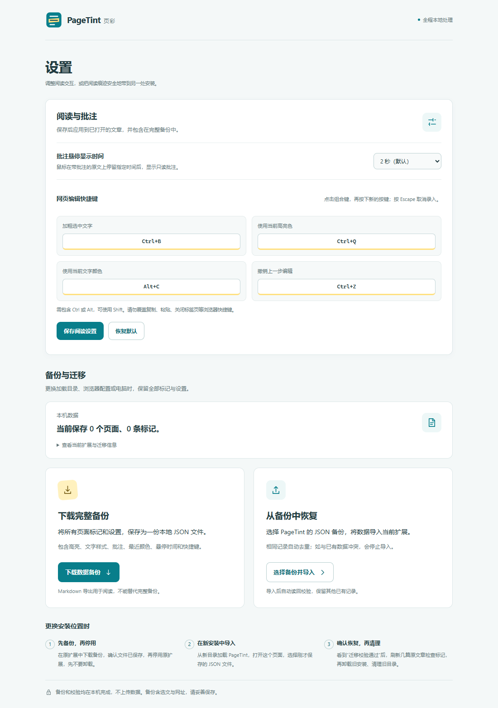

<div align="center">
  

  <h1>PageTint · 页彩</h1>

  <p><strong>在网页上标出重点，把阅读痕迹留在本机。</strong><br>
  Highlight, annotate, and keep your reading local.</p>

  <p>
    <a href="LICENSE"></a>
    
    
    
  </p>

  <p><a href="#功能">功能</a> · <a href="#界面预览">界面预览</a> · <a href="#安装">安装</a> · <a href="#使用">使用</a> · <a href="#导出与备份">导出与备份</a> · <a href="#开发">开发</a></p>
</div>

PageTint 是一个轻量的 Chrome 网页标记扩展。选中文字即可高亮、调整文字颜色、加粗、添加下划线或撰写批注；再次打开网页时，标记会按原文和上下文尝试恢复。批注支持 TeX 数学公式，文章也可以导出为保留样式与批注的 Markdown，放入 Obsidian 继续阅读。

**无需账户、服务器或构建步骤。网页正文、标记和设置均保存在本机。**

> [!IMPORTANT]
> 本文对应 **0.11.0 源码**。Chrome 商店提交包仍为 **0.9.3**，不包含 0.10.x 的启用控制和 0.11.0 的批注、公式及阅读设置；实际审核与发布状态以商店为准。需要旧版源码，可查看 [0.9.3 源码快照](https://github.com/SWAlbert-0/PageTint/tree/12c26a84493ddefb5d5019142978c4bf8b7d6baa)。

## 功能

| 能力 | 说明 |
| --- | --- |
| 网页标记 | 高亮、文字颜色、加粗、下划线、点击换色、选区复原与最多 100 步撤销 |
| 灵活配色 | 常用色、各 24 个扩展预设色、自定义 HEX，分别记忆最近使用的六种颜色 |
| 批注评论 | 为选文添加、修改或删除批注；悬停查看只读内容，长批注独立滚动 |
| TeX 公式 | 行内与块级公式实时预览，本地 KaTeX 生成 MathML，不请求 CDN 或远程字体 |
| 阅读设置 | 自定义批注悬停时间，以及高亮、加粗、文字颜色和撤销快捷键 |
| 本机恢复 | 自动保存标记与偏好，再访时按原文及上下文重新定位 |
| 页面管理 | 同篇文章自动归并，打开原文或删除该页全部编辑数据 |
| Markdown 导出 | 导出完整正文、局部样式和批注，一页一文件，手动下载 |
| 备份与迁移 | 完整 JSON 备份，包含标记与设置；跨安装导入后读回校验 |
| 启用控制 | 总开关、文章页智能识别、网站手动规则与本机地址排除 |

## 界面预览

### 在原文中直接编辑

五个主要操作保持单行，色板、批注和公式预览围绕选文展开。标记只改变本地页面显示，不修改服务器原文。

<div align="center">
  
</div>

### 从弹窗到设置页

<table>
  <thead>
    <tr>
      <th width="50%">弹窗 · 导出与页面管理</th>
      <th width="50%">设置 · 阅读偏好与完整备份</th>
    </tr>
  </thead>
  <tbody>
    <tr>
      <td></td>
      <td></td>
    </tr>
    <tr>
      <td>控制启用范围，导出当前文章，查看批注数量或删除页面数据。</td>
      <td>调整悬停时间和快捷键，下载完整备份，或跨安装导入并校验。</td>
    </tr>
  </tbody>
</table>

截图均来自当前界面；演示正文为项目示例文本。

## 安装

目前通过 Chrome 开发者模式加载，仓库源码即可运行。

1. 下载并解压源码，或克隆仓库：

   ```bash
   git clone https://github.com/SWAlbert-0/PageTint.git
   ```

2. 打开 `chrome://extensions`，开启 **开发者模式**。
3. 点击 **加载已解压的扩展程序**，选择包含 `manifest.json` 的项目根目录。
4. 刷新已打开的文章，选中文字开始使用。

安装不需要执行 `npm install`。更新源码后，在扩展管理页点击 **重新加载**，再刷新文章。请尽量保持加载目录不变；换目录或换电脑前先完成备份。

## 使用

### 控制启用范围

弹窗顶部的 **启用 PageTint** 是总开关。关闭后停止网页编辑、快捷键和标记恢复，并还原当前页面显示；已有数据仍保留。

默认自动识别文章、博客和文档页。识别不准确时，可将当前网站设为 **始终启用** 或 **始终停用**。页面数据、设置和备份在总开关关闭时仍可使用。

<details>
<summary><strong>查看网站规则与本机地址限制</strong></summary>

- 网站规则针对完整域名，HTTP/HTTPS 共用，不自动包含子域；切回自动识别会移除该网站的手动规则。
- `localhost` 及其子域、`127.x.x.x`、IPv6 回环地址、`0.0.0.0` 和 `[::]` 固定停用，不区分端口，手动启用不能覆盖。
- 功能启用范围不会减少 Chrome 已授予的网站访问权限。需要限制访问时，请在 Chrome 扩展详情中设置允许的网站。

</details>

### 标记正文

选中文字后，浮动工具栏会出现在选区附近：

- 点击 **高亮、加粗、下划线** 应用样式；两行色板分别控制高亮色和文字色。
- 每行末尾的彩色按钮展开更多预设色、最近使用和自定义颜色。
- HEX 支持 `#RRGGBB` 与 `#RGB`；点击已有标记可直接换色。
- **复原** 清除选区中的插件样式，保留网页原有格式；部分复原不会清除选区之外的样式。
- 编辑自动保存。撤销记录最多 100 步，刷新后清空；已保存的标记仍保留，目前不支持重做。

| 默认快捷键 | 操作 |
| --- | --- |
| `Ctrl+B` | 加粗选中文字 |
| `Ctrl+Q` | 使用当前高亮色 |
| `Alt+C` | 使用当前文字颜色，首次默认为红色，之后复用最近选择的文字色 |
| `Ctrl+Z` | 撤销当前页的上一步编辑 |
| `Escape` | 依次收起浮层、色板、批注或工具栏 |

前四项组合键均可在 **设置 → 阅读与批注** 中修改。点击组合键后录入新按键，保存前会检查重复及常见浏览器冲突。输入框和网页编辑器保留原本的输入快捷键。

### 添加批注与数学公式

选中文字后点击 **批注**，无需先添加高亮。已有批注的原文下方显示青色虚线：

- **悬停查看**：默认连续悬停 2 秒显示只读批注，可在设置中调整为 0.5–10 秒或关闭。
- **点击编辑**：点击原文，再点击 **批注**，可修改或删除；支持撤销。
- **长批注**：输入与预览分别滚动，保存按钮始终可见；只读浮层内部也可滚动。
- **安全显示**：普通批注按纯文本处理，不执行其中的 HTML。

公式使用 KaTeX 支持的 TeX 语法：

```text
行内：$E=mc^2$ 或 \(E=mc^2\)
块级：$$\int_0^1 x^2\,dx=\frac{1}{3}$$ 或 \[...\]
字面美元符号：\$
```

公式在编辑区实时预览，语法错误会提示并阻止保存。扩展本地打包 KaTeX 0.16.22，仅生成 MathML；支持常用数学命令，不等同于完整 LaTeX 文档环境。按 `Ctrl+Enter` 保存批注。

### 管理页面数据

弹窗的 **页面数据** 按文章归并标记，只展示标题、地址、批注数量和最近编辑时间。普通小节锚点、已知追踪参数及查询顺序差异不会拆页；区分章节的业务参数和 SPA 路由会保留。Hello-Agents 文档站的 Docsify 小节也按同一章节归并。

删除页面会清除该页全部编辑，且无法通过 Ctrl+Z 恢复。

## 导出与备份

### 导出到 Obsidian

打开原文章并等待正文加载，点击 **导出当前页 Markdown**，将下载的 `.md` 文件放入 Obsidian 仓库。

- 导出完整正文，不只是重点摘录；尽量排除导航、侧栏、页脚和编辑控件。
- 标题、段落、列表、引用、链接、普通表格和代码尽量转换为标准 Markdown。
- 颜色、下划线和叠加效果使用少量内联 HTML；批注按原文位置附在文末，TeX 保留源码。
- 文件包含标题、来源 URL、导出时间和标签属性，无需额外 Obsidian 插件即可阅读。
- **图片保留在线链接，不下载附件**；需要登录、已删除或限制外部引用的图片可能无法显示。
- 导出对象是当前活动网页，不能仅凭本地标记还原未打开文章的全文。

Markdown 用于阅读，不能替代扩展数据备份。

### 完整备份与迁移

**设置 → 备份与迁移** 可下载完整 JSON，包含页面标记、批注、颜色偏好、悬停时间、快捷键及其他本地设置。

1. 在原安装中下载备份并确认文件已保存。
2. 停用原扩展，先不要卸载；从新目录加载 PageTint。
3. 在新安装的设置页选择 JSON 文件并导入。
4. 确认 **迁移校验通过**，刷新原文章检查标记，再清理旧安装。

导入会检查文件摘要并在写入后读回校验。重复记录不会增加副本；同键不同值会停止导入，不自动覆盖。备份包含选文和网址，请勿提交到公开仓库或 Issue。

## 数据与隐私

PageTint 使用 `chrome.storage.local`，没有后端、账户、广告、分析或云同步，不主动上传网页正文及标记。

| 权限 | 用途 |
| --- | --- |
| `storage` | 保存标记、批注、颜色与阅读偏好、迁移校验信息 |
| `activeTab` | 打开弹窗后识别当前标签页，并请求正文导出 |
| HTTP / HTTPS 站点访问 | 加载选文工具并恢复标记；可在 Chrome 扩展详情中限制 |

**卸载扩展会清除该安装的本地数据**，卸载或换路径前请备份。默认本地存储配额约为 10 MB。详见 [隐私说明](docs/privacy.md)。

<details>
<summary><strong>适用范围与已知限制</strong></summary>

- 适合普通网页文章、博客和技术文档正文。
- 暂不支持内置 PDF 阅读器、图片文字、Canvas、iframe、Shadow DOM 内正文或浏览器内部页面。
- 高频重绘、虚拟滚动和复杂富文本网站可能需要单独适配；正文变化过大时，标记可能无法重新定位。
- 只处理当前已加载的正文，不自动展开折叠内容或遍历分页。
- 导出不复刻整站 CSS；复杂表格、图表、媒体和无法提取 TeX 源码的公式可能无法完整转换。
- 自定义颜色在不同主题中可能有不同观感，请检查目标阅读环境的对比度。

</details>

## 开发

扩展无需构建。Node.js 22+ 仅用于开发测试；KaTeX 已复制到 `vendor/`，运行时不加载 `node_modules`。

```bash
npm install --ignore-scripts
npm test
npm run test:dom
```

测试覆盖定位、页面归并、颜色、撤销、迁移、快捷键与设置、批注公式、MathML 安全渲染、正文导出和下载消息流程。DOM 检查使用 jsdom，不替代真实 Chrome 与 Obsidian 的视觉验收。

<details>
<summary><strong>源码结构</strong></summary>

```text
manifest.json      扩展声明、权限与图标
content.js         选文工具栏、批注浮层、样式恢复与编辑
core.js            定位、颜色、撤销、页面归并与阅读偏好
activation.js      文章识别、总开关与网站规则
comments.js        批注公式解析、安全预览与 MathML 渲染
exporter.js        正文提取、批注和 Markdown / HTML 转换
popup.*            弹窗、页面管理与下载
migration*         设置页布局、完整备份、迁移及校验
settings.js        悬停时间与快捷键设置
vendor/            本地 KaTeX 渲染器及许可
tests/             单元测试和 DOM 集成样例
docs/images/       当前界面截图
```

</details>

修改图标后可运行 `python scripts/render_icons.py` 重新生成 PNG；仅该脚本需要 Pillow。

欢迎通过 [Issues](https://github.com/SWAlbert-0/PageTint/issues) 反馈问题或提交 Pull Request。兼容性问题请提供公开 URL、复现步骤和浏览器版本，不要上传个人备份。参见 [贡献说明](CONTRIBUTING.md)。

## License

[MIT](LICENSE) © 2026 [SWAlbert-0](https://github.com/SWAlbert-0)。允许使用、修改及商业分发，分发时须保留版权声明和许可文本。
